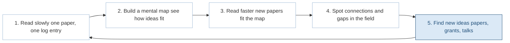
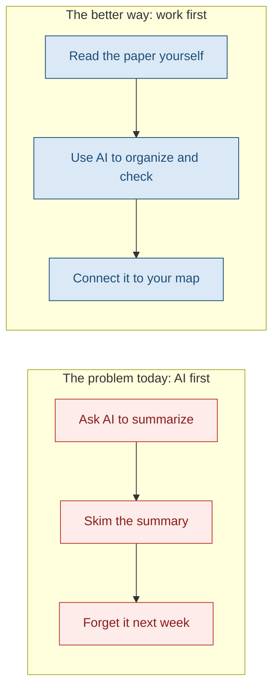

# Why the Literature Review Matters

**What two years of slow reading taught me**

Created by Dr. Michelle Angelo-Rocha · License: CC BY 4.0

## The problem

Students often hear "read the literature" as a rule, not a reason. Reading one paper carefully can take a whole day, and it can feel like wasted time, because the payoff doesn't show up right away.

## My story

Two years ago, I read more than 80 sources for a report on cybersecurity education programs. Many of those papers felt slow and boring. Some days I read just one.

Two years later, the connections started showing up everywhere. New papers made sense faster because I already had a map in my head. I could see what was missing in a field because I knew what was already there. Ideas for projects, grants, and papers came from that map.

That is why I now tell my students to read. It doesn't make sense at first. It makes sense when you start working in the field.

If reading feels slow, overwhelming, or pointless right now, that is normal. It is the first part of the path, not a sign you are doing it wrong. Every paper you read adds to a map that few people have. Over time, that map is what makes you the specialist in your topic: the person who knows what has been done, sees what is missing, and can explain why it matters.

## Reading builds like savings

At first it feels like nothing is happening. Then it starts to compound.

## Read in layers

Not every paper needs a deep read.

1. **Skim (about 15 minutes):** read the abstract, introduction, figures, and conclusion. Decide where the paper fits.
2. **Deep read:** save slow, careful reading for the few papers that matter most for what you are working on now.
3. **Connect:** write one line about how the paper links to what you already know.

## Connection log template

Keep a running log. Over time, it becomes your map.

| Paper | Main idea | Connects to | Gap or question | How I might use it |
| --- | --- | --- | --- | --- |
| Author (Year) | One sentence | Another paper or project | What is missing? | Paper, grant, class, talk |

## Using AI without losing the thinking

**The problem today:** many people use AI first and do the thinking later, or never. The thinking is the skill. To grow, improve, adapt, and develop expertise, do the work first, then use AI.

AI is a great assistant, not a substitute for thinking. Read first. Then use AI to organize your notes, check your understanding, or find related work.

**I struggle with this too.** We are all busy, and AI is fast and always there. When ten things are due, the slow path can feel impossible. So it doesn't have to be all or nothing:

- **Protect the thinking where it matters most:** read and think yourself for the work that builds your expertise, like your research area.
- **Let AI help with routine tasks:** formatting, emails, and organizing notes.
- **Write first, then ask:** before asking AI anything, write down two sentences of your own thinking.

## When you have too many projects

You only have 24 hours in a day. Read first for whatever is due next, and keep a running note of connections as you go. The rest can wait in your log.

## Doubting yourself is part of it

Even after years of reading, you may still feel you don't know enough. That feeling is normal. It often means you know enough to see how much more there is to learn.

## Start small: a one-month challenge

Read one paper a week for a month, and write one entry in your connection log for each. Four papers, four entries. That is how your map begins.

## For students

- Reading slowly is not wasting time. It is how expertise is built.
- Start small: one paper, one log entry.
- Expect the payoff later, sometimes years later.
- Share what you learn. Your map can help someone else start theirs.

## License

This guide is shared under CC BY 4.0. You may use and adapt it with credit to Dr. Michelle Angelo-Rocha.
