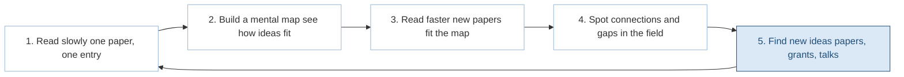
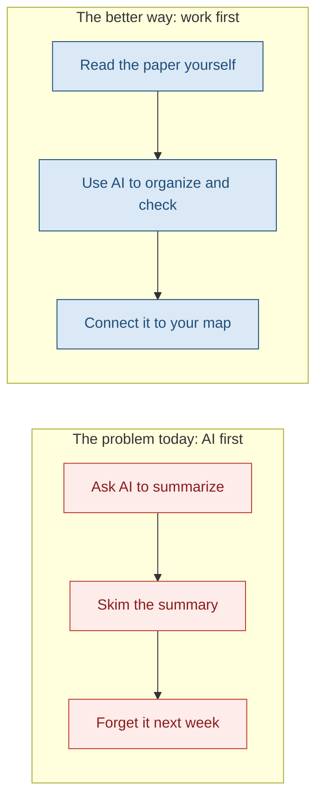

# Why the Literature Review Matters

**English** · [Português](README.pt.md) · Español (coming soon)

**What two years of slow reading taught me**

Created by Dr. Michelle Angelo-Rocha · License: CC BY 4.0

## Why it matters

### The problem

Students often hear "read the literature" as a rule, not a reason. Reading one paper carefully can take a whole day, and it can feel like wasted time, because the payoff doesn't show up right away.

### My story

Two years ago, I led my first empirical research project on my own, a study of cybersecurity workforce programs. I had worked on research with others before, but this time I was the lead. I read more than 80 sources. The papers felt slow and challenging, written in a very academic way. Some days I read just one, and I felt frustrated. I had impostor syndrome. I kept asking myself why I couldn't read faster.

It was also my first time working with a research assistant. I was teaching her while I was still learning myself.

Two years later, the connections started showing up everywhere. New papers made sense faster. People started inviting me into projects. Ideas came from what felt like nowhere, but they really came from those papers, case studies, and reports. I began to understand how programs are evaluated, which metrics are missing, and what we should measure when we create educational programs.

Today, that slow reading shapes how I read, how I design curriculum and programs, how I evaluate them, and how I think ahead as a project manager. I would not have this knowledge without it. Reading, combined with hands-on practice, is what makes you a specialist in a topic. That is what worries me when people let AI read for them: they skip the slow process where the real learning happens.

I know it's overwhelming. And it may feel like a waste of time. But I promise you, it's not a waste of time.

### Reading builds like savings

At first it feels like nothing is happening. Then it starts to compound.

## How to do it

### Read in layers

Not every paper needs a deep read.

1. **Skim (about 15 minutes):** read the abstract, introduction, figures, methodology, results, and conclusion. Decide where the paper fits.
2. **Deep read:** save slow, careful reading for the few papers that matter most for what you are working on now.
3. **Connect:** write one line about how the paper links to what you already know.

### Build a literature review matrix

Keep one spreadsheet for every paper you read. Over time, it becomes your map.

| Citation | Purpose | Methods | Key findings | Connects to | Gap or question | How I might use it |
| --- | --- | --- | --- | --- | --- | --- |
| Author (Year) | What the study asks | Design, sample, data | One or two sentences | Another paper or project | What is missing? | Paper, grant, class, talk |

**[Download the literature review matrix](literature-review-matrix.csv)**

### How I teach my students to read

- **Write a short summary of each reading** in one running document.
- **Fill in the literature review matrix** with the key details of each paper, so you can find them again later.
- **Organize your papers** in a reference manager like Zotero or Mendeley.

My students don't always see why this matters at first. But I promise them it will help them in the future.

### Using AI without losing the thinking

**The problem today:** many people use AI first and do the thinking later, or never. The thinking is the skill. To grow, improve, adapt, and develop expertise, do the work first, then use AI.

AI is a great assistant, not a substitute for thinking. Read first. Then use AI to organize your notes, check your understanding, or find related work.

## When it feels hard

### I struggle with this too

We are all busy, and AI is fast and always there. When ten things are due, the slow path can feel impossible. So it doesn't have to be all or nothing:

- **Protect the thinking where it matters most:** read and think yourself for the work that builds your expertise, like your research area.
- **Let AI help with routine tasks:** formatting, emails, and organizing notes.
- **Write first, then ask:** before asking AI anything, write down two sentences of your own thinking.

### When you have too many projects

You only have 24 hours in a day. Read first for whatever is due next, and keep a running note of connections as you go. The rest can wait in your matrix.

### Doubting yourself is part of it

Even after years of reading, you may still feel you don't know enough. That feeling is normal. It often means you know enough to see how much more there is to learn.

## For students

- Reading slowly is not wasting time. It is how expertise is built.
- **Start small with a one-month challenge:** read one paper a week, and add one row to your matrix for each. Four papers, four rows. That is how your map begins.
- Expect the payoff later, sometimes years later.
- Share what you learn. Your map can help someone else start theirs.

## For instructors

A one-week activity to introduce the literature review:

1. **Before class:** each student reads one assigned paper and fills in one row of the matrix.
2. **In class:** in pairs, students compare their rows and find one connection and one gap between their papers.
3. **Wrap-up:** each pair shares their connection with the class, and you build a shared matrix together.
4. **Reflection:** students write two sentences on what they understood only after reading the paper themselves.

## Further reading

- Boote, D. N., & Beile, P. (2005). Scholars before researchers: On the centrality of the dissertation literature review in research preparation. *Educational Researcher, 34*(6), 3–15. https://doi.org/10.3102/0013189X034006003
- Hart, C. (2018). *Doing a literature review: Releasing the research imagination* (2nd ed.). SAGE. https://sk.sagepub.com/book/mono/doing-a-literature-review-2e/toc#_

- ## How to cite this guide

Angelo-Rocha, M. (2026). *Why the literature review matters: What two years of slow reading taught me* [Open educational resource]. GitHub. https://github.com/michelleangelorocha/why-literature-review-matters

## License

This guide is shared under CC BY 4.0. You may use and adapt it with credit to Dr. Michelle Angelo-Rocha.
