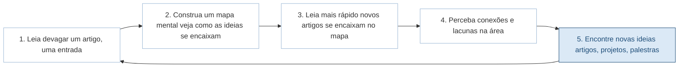
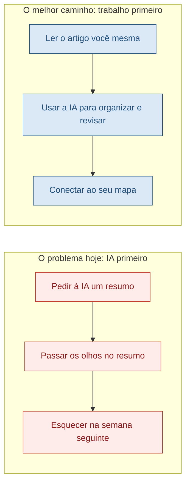

English · **Português** · Español (em breve)

# Por que a revisão de literatura importa

**O que dois anos de leitura lenta me ensinaram**

Criado pela Dra. Michelle Angelo-Rocha · Licença: CC BY 4.0

## Por que importa

### O problema

Estudantes costumam ouvir "leia a literatura" como uma regra, não como um motivo. Ler um artigo com cuidado pode levar um dia inteiro, e pode parecer perda de tempo, porque o resultado não aparece logo.

### Minha história

Há dois anos, liderei sozinha meu primeiro projeto de pesquisa empírica, um estudo sobre programas de formação da força de trabalho em cibersegurança. Eu já tinha feito pesquisa com outras pessoas, mas, dessa vez, eu era a líder. Li mais de 80 fontes. Os artigos pareciam lentos e desafiadores, escritos de forma muito acadêmica. Em alguns dias, eu lia apenas um, e me sentia frustrada. Eu sentia a síndrome do impostor. Eu me perguntava por que não conseguia ler mais rápido.

Também foi minha primeira vez trabalhando com uma assistente de pesquisa. Eu a ensinava enquanto ainda estava aprendendo.

Dois anos depois, as conexões começaram a aparecer em todo lugar. Novos artigos passaram a fazer sentido mais rápido. As pessoas começaram a me convidar para projetos. As ideias pareciam vir do nada, mas, na verdade, vinham daqueles artigos, estudos de caso e relatórios. Comecei a entender como os programas são avaliados, quais métricas estão faltando e o que devemos medir ao criar programas educacionais.

Hoje, aquela leitura lenta influencia como eu leio, como desenho currículos e programas, como os avalio e como planejo com antecedência como gerente de projetos. Eu não teria esse conhecimento sem ela. A leitura, junto com a prática, é o que faz de você especialista em um tema. É isso que me preocupa quando as pessoas deixam a IA ler por elas: elas pulam o processo lento, onde o aprendizado de verdade acontece.

Eu sei que é muita coisa. E pode parecer perda de tempo. Mas eu prometo: não é perda de tempo.

<!-- Cole aqui a linha da sua imagem -->

### A leitura rende como uma poupança

No começo, parece que nada está acontecendo. Depois, tudo começa a se somar.

## Como fazer

### Leia em camadas

Nem todo artigo precisa de uma leitura profunda.

1. **Leitura rápida (cerca de 15 minutos):** leia o resumo, a introdução, a metodologia, as figuras e a conclusão. Decida onde o artigo se encaixa.
2. **Leitura profunda:** reserve a leitura lenta e cuidadosa para os poucos artigos mais importantes para o que você está fazendo agora.
3. **Conecte:** escreva uma linha sobre como o artigo se relaciona com o que você já sabe.

### Monte uma matriz de revisão de literatura

Mantenha uma planilha com todos os artigos que você lê. Com o tempo, ela se torna o seu mapa.

| Referência | Objetivo | Métodos | Principais resultados | Conecta com | Lacuna ou pergunta | Como posso usar |
| --- | --- | --- | --- | --- | --- | --- |
| Autor (Ano) | O que o estudo pergunta | Desenho, amostra, dados | Uma ou duas frases | Outro artigo ou projeto | O que está faltando? | Artigo, projeto, aula, palestra |

**Baixe a matriz de revisão de literatura**

### Como ensino meus alunos a ler

- **Escreva um breve resumo de cada leitura** em um único documento.
- **Preencha a matriz de revisão de literatura** com os principais detalhes de cada artigo, para encontrá-los depois.
- **Organize seus artigos** em um gerenciador de referências, como o Zotero ou o Mendeley.

Meus alunos nem sempre entendem, no início, por que isso importa. Mas eu prometo a eles que isso vai ajudar no futuro.

### Usar a IA sem perder o pensamento

**O problema hoje:** muitas pessoas usam a IA primeiro e pensam depois, ou nunca. O pensamento é a habilidade. Para crescer, melhorar, se adaptar e desenvolver expertise, faça o trabalho primeiro e use a IA depois.

A IA é uma ótima assistente, não um substituto para o pensamento. Leia primeiro. Depois, use a IA para organizar suas anotações, conferir sua compreensão ou encontrar trabalhos relacionados.

## Quando fica difícil

### Eu também luto com isso

Estamos todos ocupados, e a IA é rápida e está sempre ali. Quando há dez coisas para entregar, o caminho lento pode parecer impossível. Por isso, não precisa ser tudo ou nada:

- **Proteja o pensamento onde ele mais importa:** leia e pense por conta própria no trabalho que constrói sua expertise, como sua área de pesquisa.
- **Deixe a IA ajudar nas tarefas rotineiras:** formatação, e-mails e organização de anotações.
- **Escreva primeiro, pergunte depois:** antes de perguntar algo à IA, escreva duas frases com o seu próprio pensamento.

### Quando você tem projetos demais

O dia só tem 24 horas. Leia primeiro o que é para entregar logo e vá anotando as conexões. O resto pode esperar na sua matriz.

### Duvidar de si faz parte

Mesmo depois de anos de leitura, você ainda pode sentir que não sabe o suficiente. Esse sentimento é normal. Muitas vezes, significa que você já sabe o bastante para ver o quanto ainda há para aprender.

## Para estudantes

- Ler devagar não é perder tempo. É assim que a expertise se constrói.
- **Comece pequeno, com um desafio de um mês:** leia um artigo por semana e adicione uma linha à sua matriz para cada um. Quatro artigos, quatro linhas. É assim que o seu mapa começa.
- Espere o retorno mais tarde, às vezes anos depois.
- Compartilhe o que você aprende. Seu mapa pode ajudar outra pessoa a começar o dela.

## Para docentes

Uma atividade de uma semana para introduzir a revisão de literatura:

1. **Antes da aula:** cada estudante lê um artigo indicado e preenche uma linha da matriz.
2. **Na aula:** em duplas, os estudantes comparam suas linhas e encontram uma conexão e uma lacuna entre os artigos.
3. **Fechamento:** cada dupla compartilha sua conexão com a turma, e vocês constroem juntos uma matriz coletiva.
4. **Reflexão:** os estudantes escrevem duas frases sobre o que só entenderam depois de ler o artigo por conta própria.

## Leituras recomendadas

- Boote, D. N., & Beile, P. (2005). Scholars before researchers: On the centrality of the dissertation literature review in research preparation. *Educational Researcher, 34*(6), 3–15. https://doi.org/10.3102/0013189X034006003
- Hart, C. (2018). *Doing a literature review: Releasing the research imagination* (2nd ed.). SAGE. https://sk.sagepub.com/book/mono/doing-a-literature-review-2e/toc

## Como citar este guia

Angelo-Rocha, M. (2026). *Por que a revisão de literatura importa: O que dois anos de leitura lenta me ensinaram* [Recurso educacional aberto]. GitHub. https://github.com/michelleangelorocha/why-literature-review-matters

## Licença

Este guia é compartilhado sob a licença CC BY 4.0. Você pode usá-lo e adaptá-lo, dando crédito à Dra. Michelle Angelo-Rocha.
